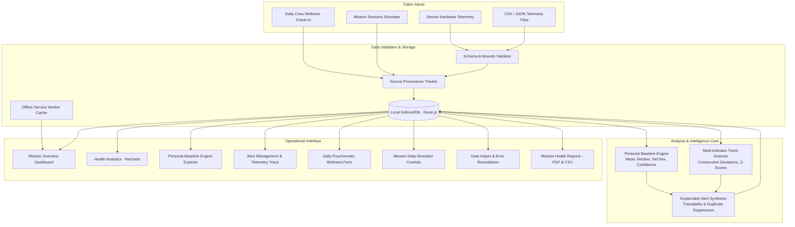

# STELLAR — Spaceflight Telemetry, Evaluation, Longitudinal Longevity & Anomaly Recognition

[](https://www.spaceappschallenge.org/)
[](https://opensource.org/licenses/MIT)
[]()
[]()
[]()

> **NASA Space Apps Challenge 2026 | Astronaut Health Monitoring Software**
> An autonomous, offline-first operational health intelligence system for long-duration deep-space exploration.

---

## 1. Project Overview

During long-duration missions beyond Low Earth Orbit (such as the Artemis lunar surface campaign and human transit to Mars), crew members operate under harsh microgravity physiological adaptations while enduring intermittent or multi-minute communication latencies with Earth (up to 22 minutes one-way delay).

Traditional terrestrial health trackers fail in this regime:
1. They evaluate astronauts against fixed, generic Earth-population clinical thresholds.
2. They rely on continuous cloud connectivity and external server backends.
3. They produce opaque "black-box" risk numbers that offer no clear mathematical traceability to mission flight rules.

**STELLAR** is built from the ground up to solve these deep-space operational challenges:
- **Personal Baseline Engine:** Calibrates individual statistical norms ($\mu, M, \sigma$, min, max, rolling windows) exclusively from each crew member's valid historical telemetry.
- **Multi-Indicator Trend Analysis:** Cross-correlates cardiovascular response, peripheral oxygenation ($\text{SpO}_2$), circadian sleep curtailment, physical countermeasure compliance, and self-reported fatigue.
- **Explainable Flight Alerts:** Deterministic, rule-governed alerts with mathematical provenance, empirical observations, and non-diagnostic operational mitigation protocols.
- **100% Offline-First Architecture:** Zero cloud dependencies. All data persists locally in IndexedDB via Dexie.js, accompanied by a Service Worker Progressive Web App (PWA) cache.

---

## 2. System Architecture



---

## 3. Technology Stack

- **Frontend:** React 18, TypeScript (Strict Mode), Vite 6, Tailwind CSS, Lucide React icons
- **Data Visualization:** Recharts (ComposedChart, Area, ReferenceLine, Tooltip)
- **Local Persistence:** IndexedDB powered by Dexie.js & `dexie-react-hooks`
- **Offline Infrastructure:** Progressive Web App (PWA) architecture with Service Worker asset caching
- **Analysis Engine:** Pure TypeScript statistical engine (deterministic, zero cloud AI APIs)
- **Reporting Engine:** Native print styling and CSV data export
- **Testing:** Vitest, React Testing Library, jsdom

---

## 4. Key Operational Features

### A. Mission Overview Dashboard
- Astronaut profile banner with callsign, mission ID, and Mission Elapsed Time (MET demo data).
- Real-time indicator cards for Resting Heart Rate, $\text{SpO}_2$, Sleep Duration, Exercise Activity, Fatigue, and Stress.
- Active alert priority list and recent telemetry stream with source provenance tagging.

### B. Interactive Health Analytics
- Configurable observation windows: **24-hour, 7-day, and 30-day views**.
- Recharts visualizations with statistical **Personal Baseline Reference Bands** ($\pm 1.5\sigma$ warning, $\pm 2.5\sigma$ urgent).
- Toggleable 3-point rolling average trend lines and interactive data inspection tooltips.

### C. Personal Baseline Engine
- Individualized reference profile calculation: Mean ($\mu$), Median ($M$), Standard Deviation ($\sigma$), Minimum, Maximum, and Sample Count.
- Strict isolation: astronaut baselines are never cross-pollinated or substituted without authorization.
- Confidence assessment: requires configurable minimum samples (default: 7) before marking a baseline as reliable; otherwise displays *"Insufficient historical data to establish a reliable personal baseline."*

### D. Explainable Alert System
- Evaluates deterministic flight rules against empirical telemetry deviations.
- Three software severity tiers: `INFO`, `WARNING`, `URGENT` (clearly identified as software monitoring priorities, not clinical diagnoses).
- Synthesizes transparent explanations detailing observed value, baseline mean, deviation, duration, and co-occurring factors.
- Integrates non-diagnostic operational protocols (e.g. sensor reseating, ECLSS cabin check, schedule de-confliction).
- Intelligent duplicate suppression prevents alert fatigue while maintaining persistence history.

### E. Daily Wellness & Psychomotor Check-in
- Crew self-report interface for sleep quality (1–5), fatigue (1–10), stress (1–10), mood (1–5), physical discomfort (1–10), and location/symptoms.
- Persists locally and immediately feeds into the multi-indicator correlation engine.

### F. Mission Data Simulator
- **Scenario 1 (Normal Mission Day):** Generates nominal telemetry within statistical bounds; dashboard remains stable.
- **Scenario 2 (Sleep Disruption):** Simulates progressive sleep loss ($<5.5\text{h}$) and fatigue accumulation ($7/10$), triggering an explainable warning alert.
- **Scenario 3 (Unusual Physiological Trend):** Simulates an acute progressive heart rate climb ($>2.5\sigma$) with slight $\text{SpO}_2$ desaturation, triggering an explainable urgent alert with persistence verification.
- Full playback controls: Start, Pause, Step Interval Speed, and Reset.

### G. Data Import & Validation Engine
- Ingests external CSV and JSON telemetry datasets.
- Validates required schema, numeric ranges, units, ISO 8601 timestamps, and deduplication.
- Displays comprehensive error messages with actionable remediation instructions.

### H. Mission Health Report & Export
- Aggregates comprehensive crew health summaries across custom time windows (24h, 7d, 14d, 30d).
- Audits and clearly distinguishes simulated, imported, and sensor records.
- Downloads full telemetry and alerts to CSV, or prints/exports formatted reports to PDF.

---

## 5. Installation & Execution

### Prerequisites
- Node.js (v18 or higher recommended; verified on Node v22)
- npm or modern package manager

### 1. Install Dependencies
```bash
npm install
```

### 2. Run the Development Server
```bash
npm run dev
```
Open your browser and navigate to `http://localhost:5173`.

### 3. Run Unit Tests
```bash
npm test
```
Executes all 19 Vitest unit tests across baseline calculations, trend detection, alert rules, validator, and simulation engine.

### 4. Build for Production
```bash
npm run build
```
Creates the production build in `dist/` with optimized bundles and PWA service worker precaching.

---

## 6. How to Demonstrate the Simulator Scenarios for Judges

1. Open the application and navigate to the **Data Simulator** tab from the sidebar.
2. **Demonstrate Scenario 1 (Normal Mission Day):**
   - Click "Scenario 1: Normal Mission Day".
   - Click **START SIMULATION**.
   - Navigate to **Mission Overview** and **Health Analytics** to show nominal stable telemetry within the green baseline reference bands with zero false alarms.
3. **Demonstrate Scenario 2 (Sleep Disruption):**
   - Return to **Data Simulator**, select "Scenario 2: Sleep Disruption", and resume simulation.
   - Within 2–3 cycles, observe sleep curtailment and fatigue accumulation.
   - Navigate to **Alerts & Events** and **Mission Overview** to show the explainable warning alert correlating sleep deficit with cardiovascular elevation.
4. **Demonstrate Scenario 3 (Unusual Physiological Trend):**
   - In **Data Simulator**, select "Scenario 3: Unusual Physiological Trend".
   - Watch resting heart rate progressively climb ($64 \rightarrow 71 \rightarrow 80 \rightarrow 91\text{ bpm}$) exceeding $+2.5\sigma$.
   - Observe the immediate generation of an **URGENT** alert with persistence tracking, supporting evidence trace, and non-diagnostic crew action protocols.

---

## 7. Two-Member Team Contribution Model

This project was built following a two-member engineering workstream approach:

| Workstream | Focus Area | Deliverables |
|---|---|---|
| **Workstream A: Data & Intelligence** | Core Computation & Models | Mathematical baseline algorithms, statistical deviation models, multi-indicator trend correlation, explainable alert engine, synthetic data generator, CSV/JSON validation rules, and comprehensive unit test suite. |
| **Workstream B: Frontend & Aerospace UX** | Product Architecture & Interface | Aerospace-grade visual design (deep navy/cyan), interactive Recharts analytics with baseline bands, daily wellness form, alert management system, offline PWA setup, and mission report PDF/CSV export. |

---

## 8. Limitations & Clinical Boundaries

1. **Non-Diagnostic Prototype:** STELLAR is an operational awareness aid and research prototype for the NASA Space Apps Challenge 2026. It is not an FDA, CE, or space agency certified medical diagnostic device.
2. **Correlation vs Causality:** Multi-indicator trends represent temporal co-occurrences and physiological stress indices, not medical diagnoses.
3. **Demonstration Thresholds:** Anomaly sensitivity rules ($\pm 1.5\sigma$ and $\pm 2.5\sigma$) are configurable demonstration parameters pending flight certification.
4. **Hardware Telemetry:** Direct Bluetooth/ANT+ biosensor integration is designed as a future module; currently simulated and file-imported telemetry are fully supported with strict provenance tracking.

---

## 9. Future Scope

- Integration with Bluetooth Low Energy (BLE) astronaut bio-harness sensors (e.g., Astroskin, Bio-Monitor).
- Real-time telemetry packet synchronization with ECLSS cabin atmospheric telemetry (CO2 partial pressure, pO2, cabin pressure).
- Cryptographic zero-knowledge verification for crew medical privacy during Earth communication passes.
- Offline voice-enabled log entry for hands-free crew reporting during intravehicular activities (IVA).

---

## 10. License & Disclosures

Distributed under the MIT License. Developed for the NASA Space Apps Challenge 2026. STELLAR explicitly discloses that all demonstration data is synthesized for software evaluation and does not represent actual NASA astronaut telemetry.
